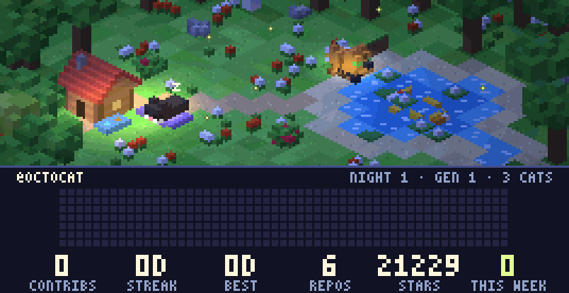

# 🐈 CATOPIA: a living cat colony for your GitHub profile

<p align="center">
  
</p>

CATOPIA is an animated banner for your GitHub profile README. Little voxel cats
live in a moonlit meadow: they wander, eat, fish, nap, make friends, have kittens
and pass their genes on. Below them sits your real contribution heatmap and stats.

The world is **persistent** and **driven by your GitHub activity**. A GitHub Action
advances it by one simulated night every hour, so your colony grows, ages and
evolves over time.

| Your activity | What happens in the meadow |
|---|---|
| Contributions this week | More food, fish and berries; more fireflies |
| Sustained activity | New berry bushes sprout (up to 4) |
| 3+ day streak | A firefly swarm |
| 7+ day streak | A lantern festival |
| New stars on your repos | A starfall night, plus golden koi in the pond (up to 5) |
| New repositories | Cardboard-box dens appear for the cats to sleep in (up to 3) |
| Your top language | The colour of the meadow flowers |

Each night also rolls its own weather (clear, fog or rain). On rainy nights the cats
stay in and nap. A family tree of every cat that has lived is published next to
the GIF as `lineage.md`.

---

## 🚀 Setup, step by step

You need a GitHub account. That's it. No server, no local install, nothing to pay
for. Everything runs on free GitHub Actions.

### Step 1: Create your profile repository

Your profile README lives in a special repository named **exactly** like your
username.

1. Go to <https://github.com/new>.
2. Set **Repository name** to your username (e.g. if you are `octocat`, name it `octocat`).
   GitHub will show a message saying *"✨ You found a secret!"*.
3. Make it **Public**.
4. Tick **Add a README file**.
5. Click **Create repository**.

> Already have a profile repo? Skip to step 2 and use the one you have.

### Step 2: Copy the CATOPIA files into it

Copy these files and folders from this repository into the **root** of your
profile repository:

```
.github/workflows/update-catopia.yml
catopia/
tests/
run.py
requirements.txt
.gitignore
```

Don't copy this `README.md`, since you keep your own. `docs/` is optional.

**Option A: in the browser (no git needed)**

1. On this repo's page click **Code → Download ZIP** and unzip it.
2. In your profile repo click **Add file → Upload files**.
3. Drag in `catopia/`, `tests/`, `run.py`, `requirements.txt` and `.gitignore`, then **Commit changes**.
4. The `.github` folder is hidden on most systems, so create the workflow by hand:
   click **Add file → Create new file**, type the name
   `.github/workflows/update-catopia.yml`, paste in the contents of
   [`.github/workflows/update-catopia.yml`](.github/workflows/update-catopia.yml),
   and **Commit changes**.

**Option B: on the command line**

```bash
git clone https://github.com/YOUR-USERNAME/YOUR-USERNAME.git
git clone https://github.com/mohid3009/Github-profile-Cat.git catopia-src
cd YOUR-USERNAME
cp -r ../catopia-src/{.github,catopia,tests,run.py,requirements.txt,.gitignore} .
git add -A
git commit -m "Add CATOPIA"
git push
```

### Step 3: Let the workflow write to your repo

The Action publishes the GIF to a branch called `output`, so it needs write access.

1. In your profile repo go to **Settings → Actions → General**.
2. Scroll to **Workflow permissions**.
3. Select **Read and write permissions**.
4. Click **Save**.

### Step 4: Run it for the first time

1. Open the **Actions** tab of your profile repo.
   If GitHub asks, click **I understand my workflows, go ahead and enable them**.
2. Click **Update CATOPIA** in the left sidebar.
3. Click **Run workflow → Run workflow**.
4. Wait about a minute for the green tick ✅.

This creates the `output` branch containing `catopia.gif`, `preview.png`,
`lineage.md` and the saved world state.

### Step 5: Show the banner on your profile

Edit your profile's `README.md` and add this where you want the banner, replacing
**both** `YOUR-USERNAME`s with your username:

```html
<p align="center">
  
</p>
```

Want a link to your colony's family tree too? Add:

```markdown
[🐾 Family tree](https://github.com/YOUR-USERNAME/YOUR-USERNAME/blob/output/lineage.md)
```

Commit, open `https://github.com/YOUR-USERNAME`, and your cats are home. 🎉
From now on the workflow runs every hour by itself.

### Step 6 (optional): Count private contributions

The built-in Actions token can only see **public** activity. To include private
contributions in the heatmap and stats:

1. Make sure **Settings → Public profile → Contributions & activity → Include private contributions on my profile** is on.
2. Create a token at <https://github.com/settings/tokens/new> (classic) with the **`read:user`** scope.
   Set an expiry you're comfortable with; you'll need to renew it when it expires.
3. In your profile repo go to **Settings → Secrets and variables → Actions → New repository secret**.
4. Name it **`CATOPIA_TOKEN`**, paste the token, and click **Add secret**.

The workflow will pick it up automatically on the next run.

---

## ⚙️ Customising

| What | How |
|---|---|
| Show a different user's stats | In the workflow's **Render** step, add `CATOPIA_USER: some-username` under `env:` |
| Update more or less often | Edit the `cron:` line in `.github/workflows/update-catopia.yml` (e.g. `"17 */6 * * *"` = every 6 hours) |
| Start the colony over | Delete the `output` branch, then run the workflow again |
| Different meadow layout | Change `SEED` in `run.py` (layouts are checked on build; if one fails its asserts, try another seed) |

Note: GitHub may delay scheduled workflows by a few minutes, and it pauses them in
repos with no activity for 60 days. Any push or a manual run turns them back on.

## 💻 Running locally

Requires Python 3.10+.

```bash
pip install -r requirements.txt
CATOPIA_USER=your-username python run.py   # fetch stats, simulate one night, render
python run.py --offline                    # reuse cached data/github.json
python run.py --nights 30                  # fast-forward 30 nights
python run.py --fresh                      # forget saved state, start from the founders
python tests/test_sim.py && python tests/test_render.py
```

Output goes to `output/` (`catopia.gif`, `preview.png`, `lineage.md`). Stats are
fetched with `$GITHUB_TOKEN`/`$GH_TOKEN`, or your `gh auth token` if the GitHub
CLI is logged in.

## 🛠️ Troubleshooting

| Problem | Fix |
|---|---|
| Broken image on the profile | The workflow hasn't run successfully yet (step 4), or the username in the image URL is wrong. Open the URL directly to check. |
| Workflow fails at "Publish" with `403` / permission denied | Turn on **Read and write permissions** (step 3). |
| Banner says *"GITHUB STATS UNAVAILABLE"* | The stats request failed. Check the workflow log; if you set `CATOPIA_TOKEN`, make sure it hasn't expired and has `read:user`. |
| Profile shows an old frame | GitHub caches images for a few minutes. Hard-refresh, or wait. |
| Private contributions missing | See step 6. |

## 🧬 How it works

- `catopia/sim.py`: a utility-AI agent simulation. Each cat scores actions
  (eat, fish, forage, nap, socialise, explore, court) against its needs and genes.
- `catopia/genetics.py`: heritable traits (fur, pattern, eyes, curiosity,
  sociability, speed, efficiency) with crossover and mutation.
- `catopia/terrain.py`, `catopia/models.py`, `catopia/render.py`: a procedural
  voxel meadow rendered as isometric pixel art with per-voxel moonlight and point lights.
- `catopia/github.py`: one GraphQL query for your contribution calendar, repos and stars.
- `run.py`: loads yesterday's world, simulates one night, renders 120 frames to a looping GIF.

See [`docs/DESIGN.md`](docs/DESIGN.md) for the full design notes.
